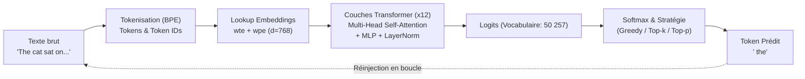
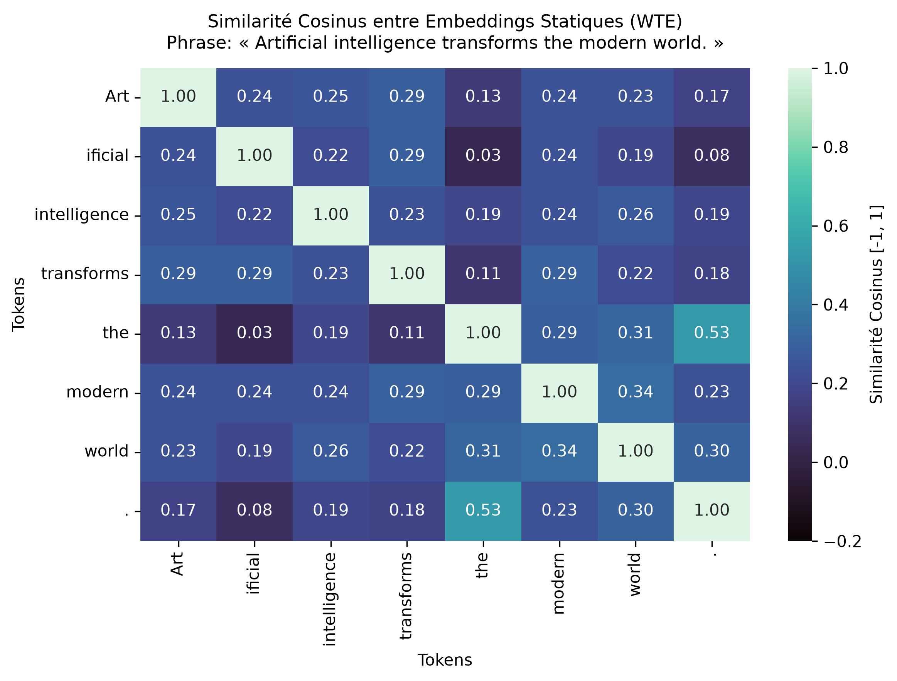
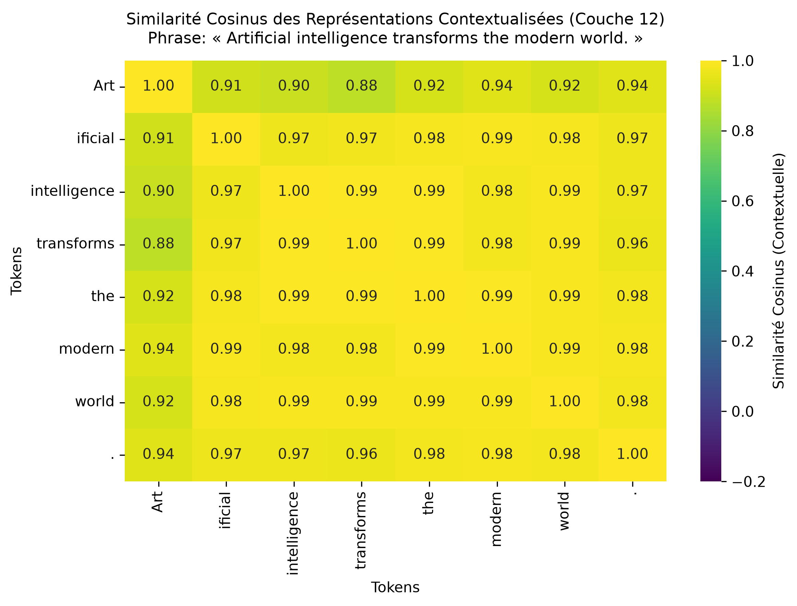
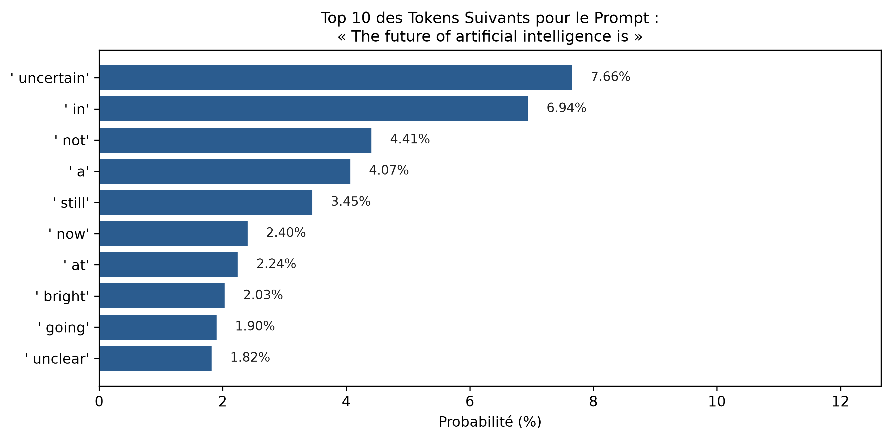
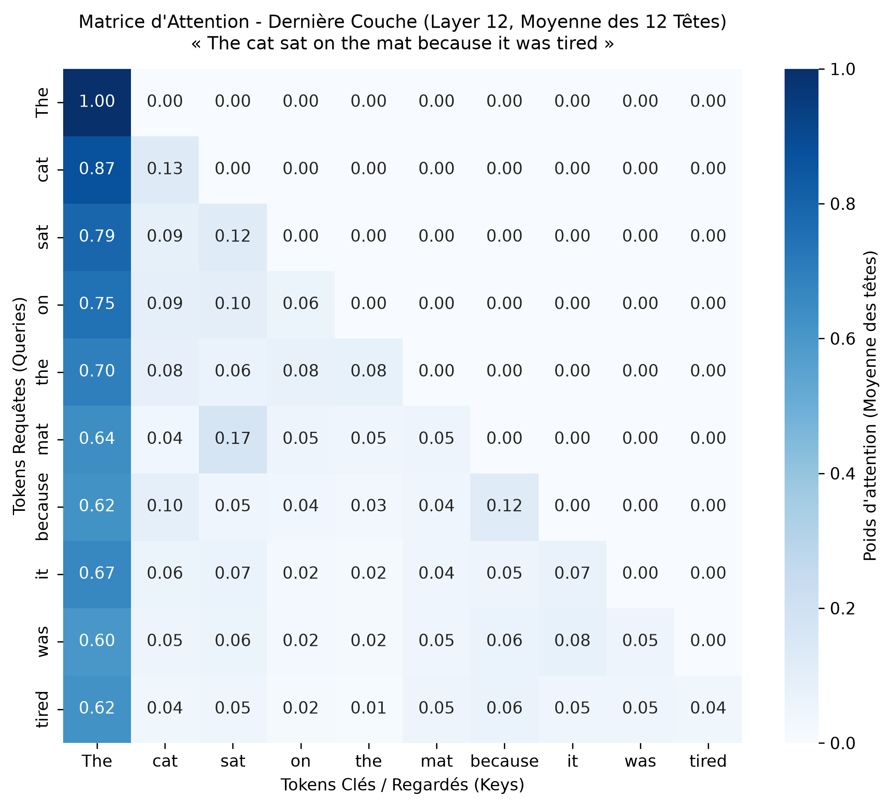
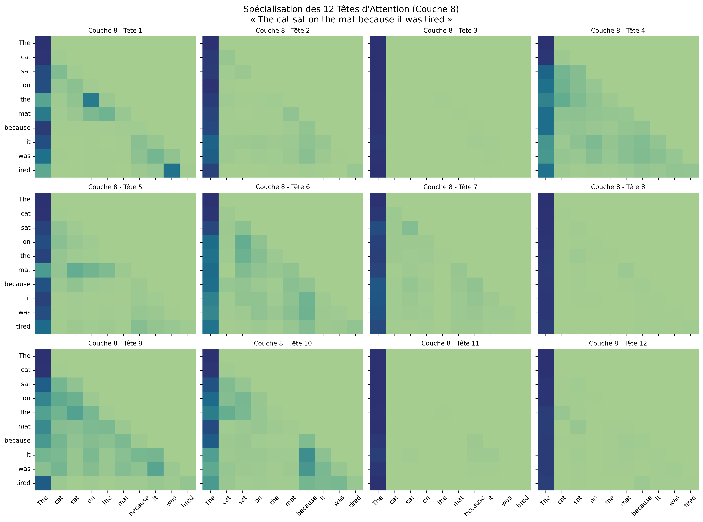
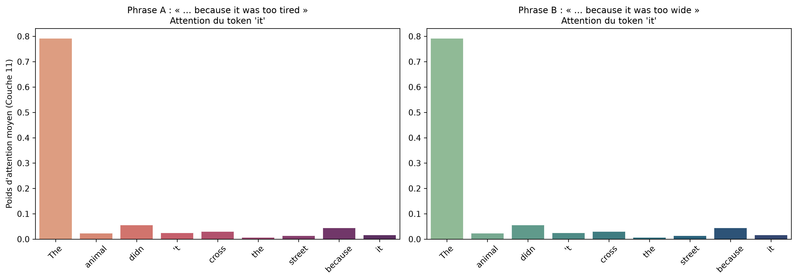

# TP 5 — LLM : Découverte pratique d'un LLM avec génération et analyse d'attention
**Filière :** Masters IADS – M2I, S3  
**Module :** Automation & Agentic AI  
**Encadrante :** Prof. Imane Lahbari  

---

## 🎯 Objectifs du TP

Ce travail pratique a pour objectif de démystifier le fonctionnement interne d'un grand modèle de langage (*Large Language Model* — LLM) basé sur l'architecture Transformer autorégressif (décodeur seul), en suivant pas à pas le cheminement d'une phrase :
1. **Comprendre la tokenisation** : Analyser le découpage en sous-mots via Byte-Pair Encoding (BPE), les IDs associés et les tokens spéciaux.
2. **Explorer les Embeddings & Similarités** : Extraire les représentations vectorielles denses (token embeddings + positional encodings) et calculer leur similarité cosinus (*cosine similarity*).
3. **Observer la génération autorégressive** : Comprendre le passage des logits aux probabilités (Softmax), et comparer les stratégies de décodage (*Greedy Search*, *Top-K*, *Top-P Nucleus Sampling*, *Température*).
4. **Visualiser le mécanisme d'attention** : Extraire les tenseurs d'attention multi-têtes (*Multi-Head Self-Attention*), inspecter le masque causal triangulaire et générer des cartes thermiques (*heatmaps*).
5. **Analyser les interactions sémantiques** : Observer comment les tokens se contextualisent mutuellement (résolution de coréférences, dépendances syntaxiques et sémantiques).

---

## 🧠 Pipeline Global d'un LLM Autorégressif

Le pipeline complet de traitement et de génération de texte se résume ainsi :



---

## 📂 Structure du Répertoire `TP5 - LLM`

```text
TP5 - LLM/
├── TP 5 LLM.pdf               # Énoncé officiel du TP
├── requirements.txt           # Dépendances du TP
├── tp5_llm.py                 # Script Python principal (étapes 1 à 5)
├── README.md                  # Rapport et guide théorique complet
└── visualisations/            # Graphiques et heatmaps générés automatiquement
    ├── 01_similarity_embeddings.png   # Matrice de similarité cosinus des embeddings
    ├── 02_next_token_probs.png        # Distribution des probabilités des tokens suivants
    ├── 03_attention_layer11_avg.png   # Heatmap d'attention (dernière couche, moyenne)
    ├── 04_attention_heads_grid.png    # Grille comparative des têtes d'attention
    └── 05_coreference_attention.png   # Analyse d'attention sur coréférence pronominale
```

---

## ⚙️ Installation & Prérequis

Les dépendances requises sont :
- `torch` : Moteur de calcul tensoriel et deep learning.
- `transformers` : Bibliothèque Hugging Face pour charger l'architecture et les poids pré-entraînés.
- `sentencepiece` & `tokenizers` : Moteurs rapides de tokenisation.
- `matplotlib` & `seaborn` : Visualisation des matrices de similarité et des poids d'attention.

Pour installer les dépendances dans votre environnement virtuel :

```powershell
pip install -r requirements.txt
```

---

## 🚀 Exécution du Projet

Le script [`tp5_llm.py`](./tp5_llm.py) est conçu de manière modulaire et peut être exécuté d'un seul trait :

```powershell
python tp5_llm.py
```

### Options en ligne de commande :
- `--step 1` : Exécuter uniquement l'étape d'introduction et inspection du modèle.
- `--step 2` : Exécuter la tokenisation et l'analyse de similarité d'embeddings.
- `--step 3` : Exécuter la génération de texte et l'inspection pas-à-pas des logits.
- `--step 4` : Exécuter l'extraction et la visualisation des poids d'attention.
- `--step 5` : Exécuter l'analyse comparée (coréférences et théorie).
- `--all` (défaut) : Exécuter l'ensemble du pipeline et sauvegarder tous les graphiques.

---

## 🔬 Détail des 5 Étapes du TP

### Étape 1 : Présentation du Modèle (GPT-2)
- **Architecture** : Décodeur Transformer pur (*Decoder-only Causal LM*).
- **Nombre de paramètres** : ~124 millions (`gpt2` base).
- **Taille de vocabulaire** : 50 257 tokens (encodage BPE).
- **Dimension d'embedding ($d_{\text{model}}$)** : 768.
- **Nombre de couches ($L$)** : 12 blocs Transformer.
- **Têtes d'attention ($H$)** : 12 têtes par couche ($d_{\text{head}} = 768 / 12 = 64$).
- **Fenêtre de contexte maximale** : 1024 tokens.

### Étape 2 : Tokenisation & Embeddings
1. **Byte-Pair Encoding (BPE)** :
   - Découpe le texte non pas en mots entiers, ni en caractères simples, mais en sous-unités fréquentes.
   - Les espaces sont représentés par le symbole spécial `Ġ` (Unicode `\u0120`).
2. **Embeddings** :
   - L'entrée $E$ est la somme de l'embedding sémantique de mot ($WTE$) et de l'embedding de position ($WPE$) :
     $$E_i = \text{WTE}[x_i] + \text{WPE}[i]$$
3. **Similarité Cosinus** :
   - Mesure l'angle sémantique entre deux vecteurs $u$ et $v$ indépendamment de leur norme :
     $$\text{CosineSimilarity}(u, v) = \frac{u \cdot v}{\|u\|_2 \, \|v\|_2}$$

### Étape 3 : Génération de Texte & Décodage
Pour générer le token suivant $x_{t+1}$ à partir du contexte $x_{1:t}$ :
1. Le modèle produit un vecteur de scores bruts (logits) $z \in \mathbb{R}^{V}$ où $V = 50\,257$.
2. Application de la fonction **Softmax** avec température $T$ :
   $$P(x_{t+1} = w_i \mid x_{1:t}) = \frac{\exp(z_i / T)}{\sum_{j=1}^V \exp(z_j / T)}$$
3. **Stratégies de décodage** :
   - **Greedy Search** : $x_{t+1} = \arg\max_i z_i$ (déterministe, risque de répétition).
   - **Température ($T$)** : $T < 1.0$ rend la distribution plus piquée (conservateur), $T > 1.0$ l'aplanit (plus créatif/diversifié).
   - **Top-K Sampling** : Filtre les $K$ tokens les plus probables avant échantillonnage.
   - **Top-P (Nucleus) Sampling** : Sélectionne le plus petit ensemble de tokens dont la somme cumulée des probabilités dépasse le seuil $P$ (ex: 0.9).

### Étape 4 : Visualisation Simplifiée de l'Attention
Le mécanisme d'attention est défini par la formule de Vaswani et al. :
$$\text{Attention}(Q, K, V) = \text{softmax}\left(\frac{Q K^T}{\sqrt{d_k}} + M\right) V$$
- $Q$ (Query), $K$ (Key), $V$ (Value) sont des projections linéaires des représentations des tokens.
- $M$ est le **masque causal triangulaire** : $M_{i, j} = -\infty$ si $j > i$, ce qui garantit qu'un token ne peut pas prêter attention aux tokens futurs.
- La matrice résultante $A \in \mathbb{R}^{N \times N}$ est triangulaire inférieure : la ligne $i$ indique comment le token $i$ distribue son attention sur les tokens $0, \dots, i$.

### Étape 5 : Discussion et Analyse Comparée
- **Coréférence pronominale** : Analyse de phrases du type Winograd Schema :
  - *"The animal didn't cross the street because it was too tired."* $\rightarrow$ Le pronom `it` prête une forte attention à `animal`.
  - *"The animal didn't cross the street because it was too wide."* $\rightarrow$ Le pronom `it` prête son attention à `street`.
- **Rôle des couches** :
  - Premières couches : capturent les relations de surface et syntaxiques immédiates (mots adjacents, déterminant-nom).
  - Couches intermédiaires et finales : capturent la sémantique globale, la résolution d'entités et la préparation du token à prédire.

---

## 📊 Résultats & Visualisations Détaillées

Tous les graphiques sont générés automatiquement dans le dossier [`visualisations/`](./visualisations/) lors de l'exécution du script.

### 1. Similarité Cosinus des Embeddings Statiques vs Contextualisés
| Embeddings Statiques (WTE) | Représentations Contextualisées (Couche 12) |
|---|---|
|  |  |

**Interprétation :**
- **Embeddings statiques (WTE)** : Mesurent la proximité lexicale intrinsèque hors contexte. Les tokens comme `'Art'` et `'ificial'` ou les mots fréquents présentent des corrélations moyennes.
- **Embeddings contextualisés (Couche 12)** : Après passage dans les 12 couches de self-attention, la similarité globale augmente considérablement : chaque token intègre l'information de toute la phrase pour former une représentation sémantique unifiée.

---

### 2. Distribution des Probabilités du Token Suivant
Prompt testé : *« The future of artificial intelligence is »*

<p align="center">
  
</p>

**Interprétation :**
- Le modèle assigne les plus fortes probabilités aux continuations logiques : `' uncertain'` (~7.66%), `' in'` (~6.94%), `' not'` (~4.41%), `' a'` (~4.07%).
- Le mécanisme de décodage auto-régressif permet de choisir :
  - **Greedy Search** : Choisit systématiquement `' uncertain'`.
  - **Top-K / Top-P Sampling** : Permet d'explorer d'autres branches plausibles (comme `' bright'` ou `' going'`) pour varier le style et la créativité.

---

### 3. Matrice de Self-Attention & Masque Causal
Phrase analysée : *« The cat sat on the mat because it was tired »*

<p align="center">
  
</p>

**Interprétation :**
- **Structure triangulaire inférieure stricte** : Tous les coefficients au-dessus de la diagonale sont nuls ($0.00$), illustrant le masque causal autorégressif.
- Le token `' tired'` distribue son attention sur les tokens précédents porteurs de sens (`' cat'`, `' was'`, `' because'`).
- La diagonale et les tokens d'ancrage (comme le premier token) reçoivent souvent une attention basale stable (*attention sink*).

---

### 4. Spécialisation des Têtes d'Attention Multi-Têtes (Couche 8)
<p align="center">
  
</p>

**Interprétation :**
- Chaque tête d'attention opère dans un sous-espace vectoriel de dimension $d_k = 64$.
- On observe clairement des motifs de spécialisation :
  - **Têtes syntaxiques** : regardent systématiquement le token immédiatement précédent ($i-1$) ou le token de début de phrase.
  - **Têtes de dépendance longue portée** : relient les pronoms aux noms et les verbes à leurs compléments.

---

### 5. Analyse de Coréférence Pronominale (Schéma de Winograd)
Comparaison du profil d'attention du pronom `'it'` :
1. *« The animal didn't cross the street because it was too tired »*
2. *« The animal didn't cross the street because it was too wide »*

<p align="center">
  
</p>

**Interprétation :**
- Dans la phrase avec *tired*, le pronom `'it'` concentre une part prépondérante de son attention sur `' animal'`.
- Dans la phrase avec *wide*, l'attention glisse vers le mot `' street'`.
- Cette capacité émergeante montre que le LLM encode du bon sens physique et sémantique dans ses couches profondes sans règles explicites préprogrammées.
